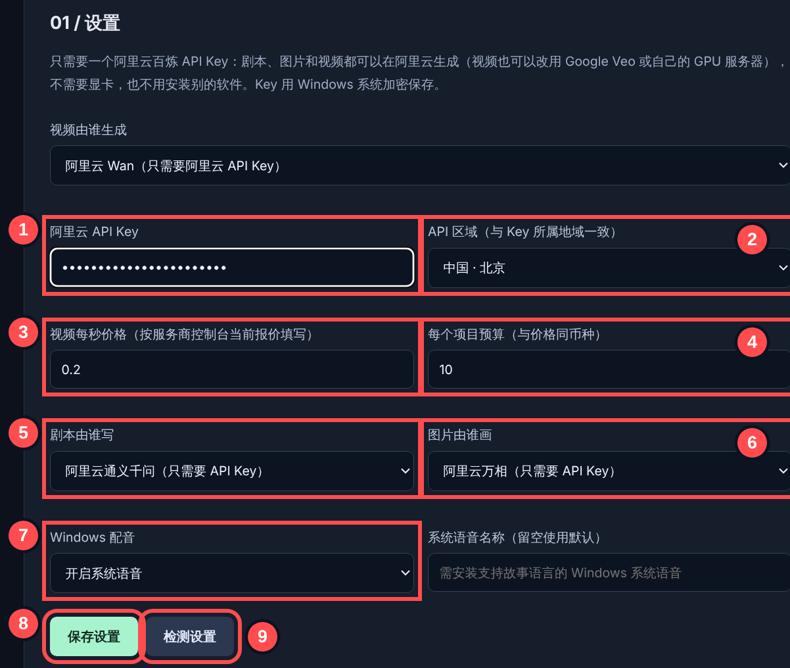
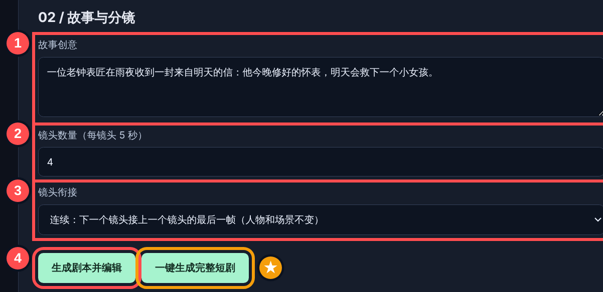
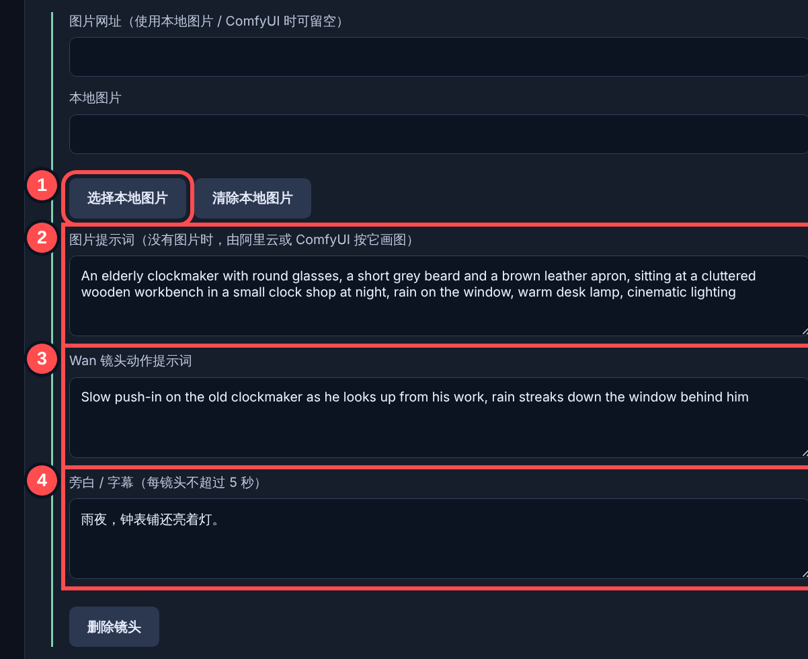
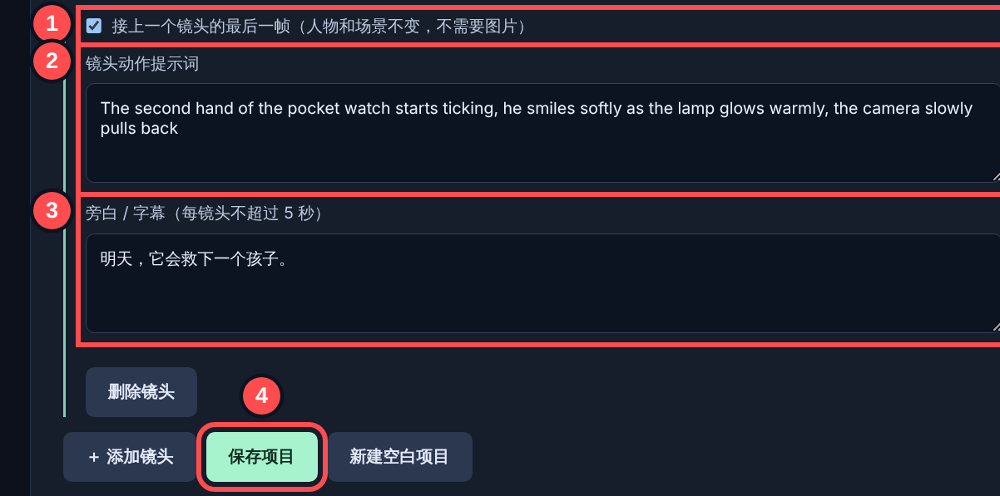
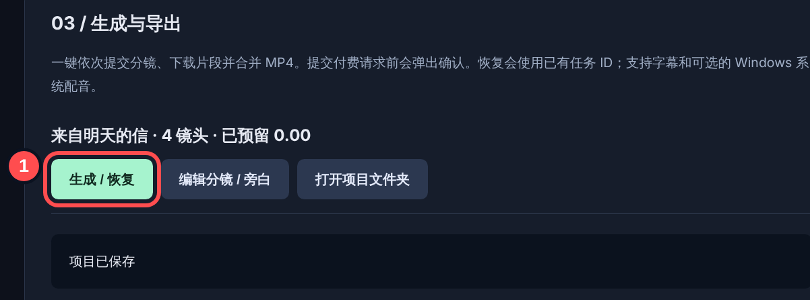
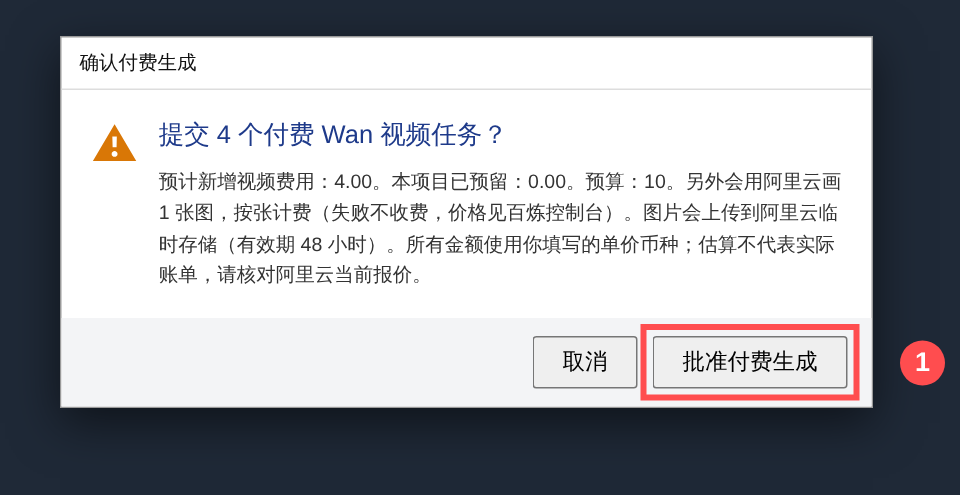
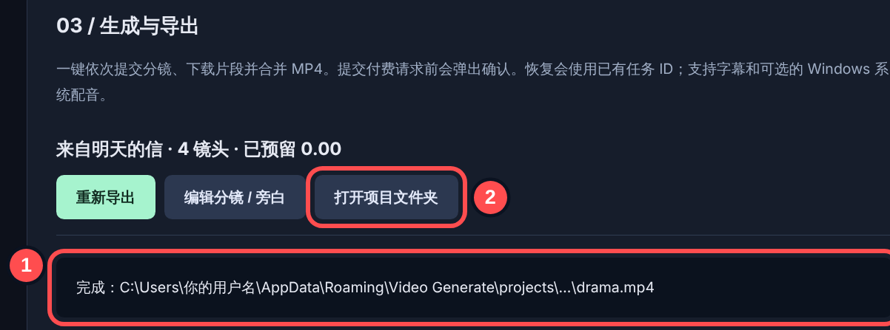

# 从 0 到完成：图解使用步骤

截图里的红圈数字就是要点击或填写的位置，按顺序做即可。整个过程只需要一个阿里云百炼 API Key，不需要显卡，也不需要安装 Ollama、ComfyUI 或 FFmpeg（安装包已自带 FFmpeg）。

## 第 0 步：准备

1. 打开 [阿里云百炼控制台](https://bailian.console.aliyun.com/) 并登录，开通百炼服务。
2. 进入 **API-KEY** 页面，点 **创建 API Key**，复制以 `sk-` 开头的 Key。它只完整显示一次，请先保存好。
3. 安装并打开 Video Generate（GitHub Actions 里最新的 Windows 安装包）。

## 第 1 步：设置（只需做一次）

| 圈号 | 做什么                                                                                                    |
| ---- | --------------------------------------------------------------------------------------------------------- |
| ①    | 粘贴 API Key。点保存后输入框会清空，这是正常的：Key 已加密保存，输入框里会显示“✓ 已加密保存”              |
| ②    | 选 Key 所属的区域：国内账号选“中国 · 北京”                                                                |
| ③    | 视频每秒价格，按百炼控制台当前报价填写                                                                    |
| ④    | 每个项目的预算上限，超出时 app 会拒绝提交                                                                 |
| ⑤    | 剧本由谁写：选“阿里云通义千问”                                                                            |
| ⑥    | 图片由谁画：选“阿里云万相”（只有电脑上已经运行 ComfyUI 时才选 ComfyUI；视频用免费的智谱时可以选“不画图”） |
| ⑦    | 需要中文配音就选“开启系统语音”                                                                            |
| ⑧    | 点 **保存设置**                                                                                           |
| ⑨    | 点 **检测设置**，看到“阿里云：API Key 已保存”就可以了                                                     |

## 第 2 步：写故事

| 圈号 | 做什么                                                                 |
| ---- | ---------------------------------------------------------------------- |
| ①    | 用一两句话写故事创意                                                   |
| ②    | 镜头数量，每个镜头 5 秒（4 个镜头约 20 秒）                            |
| ③    | 选“连续”：后一个镜头接上一个镜头的最后一帧，人物和场景保持一致         |
| ④    | 点 **生成剧本并编辑**，等待剧本出现                                    |
| ★    | 不想检查剧本，可以直接点 **一键生成完整短剧**（会跳到第 5 步的确认框） |

## 第 3 步：检查镜头（可选）

| 圈号 | 做什么                                                   |
| ---- | -------------------------------------------------------- |
| ①    | 有自己的图片才点；没有就不用管，阿里云会按 ② 画图        |
| ②    | 图片提示词（英文效果更好）：描述第一个画面里的人物和场景 |
| ③    | 镜头动作提示词：这 5 秒里画面怎么动                      |
| ④    | 旁白 / 字幕，每个镜头一句短话                            |

| 圈号 | 做什么                                                    |
| ---- | --------------------------------------------------------- |
| ①    | 第 2 个镜头起默认勾选“接上一个镜头的最后一帧”，不需要图片 |
| ②    | 这个镜头的动作                                            |
| ③    | 这个镜头的旁白                                            |
| ④    | 改完后点 **保存项目**                                     |

## 第 4 步：开始生成

① 在“03 / 生成与导出”里点 **生成 / 恢复**。

## 第 5 步：确认费用

① 看清预计费用后点 **批准付费生成**。点“取消”不会花钱。

之后每个镜头需要几分钟，请保持 app 打开、电脑不要睡眠。中途关掉也没关系：再次打开后点 **生成 / 恢复**，会接着之前的任务继续，不会重复收费。

## 第 6 步：拿到视频

| 圈号 | 做什么                                          |
| ---- | ----------------------------------------------- |
| ①    | 显示“完成：…drama.mp4”就是做好了                |
| ②    | 点 **打开项目文件夹**，`drama.mp4` 就是成品短剧 |

想改旁白或字幕：点“编辑分镜 / 旁白”，改完保存，再点“重新导出”，不会产生新的视频费用。已经生成的镜头画面不能再改；想换画面，请用新项目重新生成。
